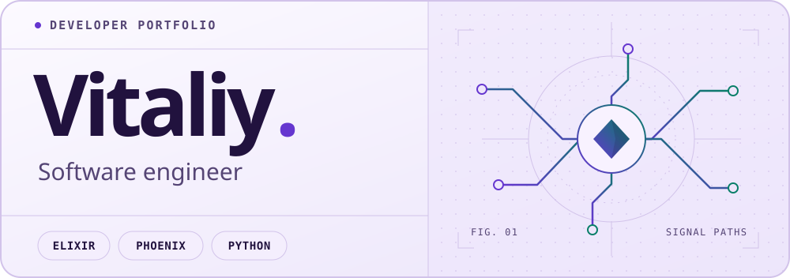

<picture>
  <source media="(prefers-color-scheme: dark)" srcset="https://raw.githubusercontent.com/Vitaly-A-Ivanov/Vitaly-A-Ivanov/HEAD/assets/profile-dark.svg?v=3">
  <source media="(prefers-color-scheme: light)" srcset="https://raw.githubusercontent.com/Vitaly-A-Ivanov/Vitaly-A-Ivanov/HEAD/assets/profile-light.svg?v=3">
  
</picture>

# Hi, I’m Vitaliy

I’m a software engineer. I build AI automations for research and software development, and real-time web apps with Elixir and Phoenix.

- **AI automation** · I use AI to take repetitive steps out of workflows and make the results easy to review.
- **Phoenix and Elixir** · I build interactive web apps with LiveView and use Elixir for the services and background jobs behind them.
